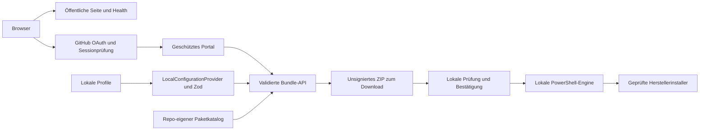
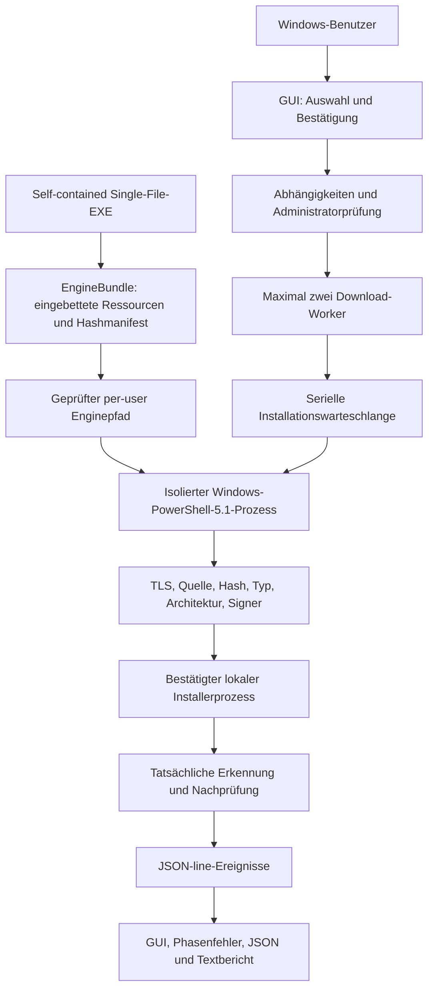
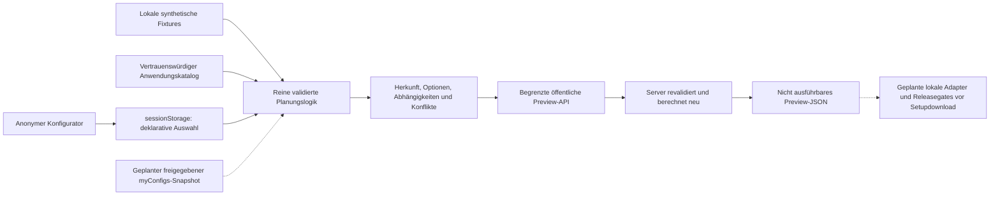

# configureMe: technischer Repository-Leitfaden

Stand: **2026-11-14**, Public-first A/B und UX #11 in main, Setup-Plan-v1 im Review-Branch; ursprüngliche geprüfte Implementierung `23fdea3b1dec546fbf73ab930096078ba73419e1` auf dem Default-Branch `main`. Dieses Dokument beschreibt Code und Prüfgrenzen, keine Produktionsfreigabe. Einstieg für Änderungen: [AGENTS.md](AGENTS.md), [TASKS.md](TASKS.md), [lokale Roadmap](ROADMAP.md), [Initialaudit](docs/audits/initial-audit.md).

## Zweck und Grenzen

configureMe erstellt nachvollziehbare Softwareauswahlen und lokale Windows-Setup-Pakete. Das Portal installiert nicht im Browser und besitzt keinen Geräte-Agenten. Die lokale Engine führt erst nach Bestätigung kontrollierte Installationsdefinitionen aus. Webportal und native EXE sind unabhängig nutzbare Einstiege; die EXE benötigt weder Portal noch Git, Node, WinGet oder globales .NET.

Implementiert sind der öffentliche Windows-Konfigurator mit synthetischen Fixtures, Mehrprofil-/Sitzungsplanung und nicht ausführbarem servervalidiertem JSON-Export sowie das weiterhin geschützte Portal, GitHub-OAuth mit Allowlist, signierte Sessions, lokaler Profilprovider, Paketkatalog, Abhängigkeitsauflösung, Windows-ZIP-Erzeugung sowie ein selbstständiges Windows-Server-2022-Setup mit WinForms, Worker und Berichten. Kein implementierter GitHub-Konfigurationsprovider, Profil-Webeditor, dauerhafte Datenbank, zentrale Session-Widerrufsdatenbank, OIDC-/Hub- oder VPN-Integration. Linux/macOS sind Planungsbezeichnungen; im aktuellen Katalog sind dafür keine installierbaren Pakete freigegeben.

## Stack und Verzeichnisse

| Pfad | Verantwortung |
| --- | --- |
| `src/app/` | Next.js 16.4.5 App Router, öffentliche Seite, geschützte Routengruppe und HTTP-APIs |
| `src/components/` | React 19.3 UI, Setup-Wizard und Portalshell; kein Installerprozess |
| `src/lib/auth.ts`, `oauth.ts`, `rate-limit.ts` | HMAC-Sessions, OAuth-/Origin-Hilfen, begrenztes In-Memory-Rate-Limit |
| `src/lib/profiles.ts` | strikte Zod-Profil-/Planschemas, lokaler Provider und topologische Auswahlauflösung |
| `src/lib/catalog.ts` | importiert den kanonischen JSON-Katalog; Plattformfilter |
| `src/lib/bootstrap.ts`, `server-bundle.ts` | Legacy-WinGet-Skript und eigenständiges Server-ZIP mit Manifest |
| `profiles/`, `schemas/` | sechs lokale Profile; veröffentlichte JSON-Schemas; semantische Katalogprüfung zusätzlich in Zod |
| `bootstrap/windows-server-2022-developer/` | vertrauenswürdiger Katalog, Serverprofil, PowerShell-5.1-Einstiegspunkt und Module |
| `windows/ConfigureMe.Setup/` | .NET 10 WinForms, eingebettete Engine, JSON-line-Workerclient, Queue und Gesamtbericht |
| `windows/ConfigureMe.Setup.Tests/`, `windows/ConfigureMe.Setup.Portable.Tests/` | Windows-GUI-/Controller-Tests und portable Teilmenge |
| `tests/`, `scripts/` | Vitest, PowerShell-Fixtures, Manifest-/ZIP-Erzeugung, optionale Diagnose-/Codex-Helfer |
| `.github/workflows/windows-quicksetup.yml` | Windows-CI mit Mocks, Self-Tests und kurzlebigen unsignierten Artefakten |
| `Dockerfile`, `compose.yaml` | vorgeschlagener eigenständiger Portalbetrieb; bekannte Reproduktionslücke siehe CM-002 |

Werkzeuge: Node.js 22+, npm/Lockfile, TypeScript 5, Zod 4, JSZip, ESLint/Vitest; native GUI `net10.0-windows`, Windows PowerShell 5.1 und `win-x64` self-contained. Keine Produktabhängigkeit auf Centrality oder Nachbar-Repositories. Details: [Architektur](docs/architecture.md), [Windows-Setup](windows/ConfigureMe.Setup/README.md).

## Aktueller Daten- und Kontrollfluss



### HTTP und Authentifizierung

| Route | Verhalten / Grenze |
| --- | --- |
| `/` | öffentlicher Windows-Konfigurator ohne Login, zeigt auch optionale Auth-Fehlerhinweise |
| `POST /api/public/plan` | begrenzte anonyme Preview-/Setup-Plan-v1-JSON-Berechnung; kein ZIP/EXE, keine Persistenz oder privaten Daten |
| `/api/health` | öffentliche statische Liveness `{status: ok}`; keine OAuth-/Deployment-Readiness-Zusage |
| `/dashboard`, `/catalog`, `/profiles`, `/setup` | über `(portal)/layout.tsx` geschützt; ohne Session Redirect |
| `GET /api/profiles` | Session erforderlich; liest alle lokalen Profile, kein Schreibendpunkt |
| `POST /api/bootstrap` | Session, Origin, Rate-Limit, 16-KiB-Bodygrenze, Zod/Katalog/Abhängigkeiten, ZIP; kein Remote-Installer |
| `GET /api/auth/github` und `/callback` | State-Cookie, Code-Austausch, GitHub-Benutzerabruf, serverseitige Login-Allowlist |
| `POST /api/auth/logout` | Originprüfung, löscht Browsercookie; keine globale Tokenwiderrufsliste |

Sessiondaten enthalten Benutzername, Rolle und Ablauf, HMAC-SHA256 mit `AUTH_SECRET`, HttpOnly/SameSite=Lax, Secure in Produktion, acht Stunden Gültigkeit. `AUTH_SECRET` muss mindestens 32 Zeichen enthalten. Allowlistprüfung erfolgt beim OAuth-Login; eine spätere Listenänderung widerruft bestehende Cookies nicht sofort. OAuth-Tokens werden nicht gespeichert; vorhandenes GitHub-Login ist kein Contents-API-Datenprovider und kein plattformweites SSO. Admin-Rolle ist Sessioninformation, kein allgemeiner Infrastrukturzugang. Siehe [Sicherheitsmodell](docs/security.md) und Audit AF-007/AF-008.

Nicht geheime Konfigurationsnamen: `APP_URL`, `INITIAL_ADMIN_GITHUB_USER`, `ALLOWED_GITHUB_USERS`, optional `CONFIGUREME_SOURCE_COMMIT`. `AUTH_SECRET`, OAuth-Client-Secret und sonstige Credentials gehören in sichere Laufzeitkonfiguration; keine Werte in Git. Produktion benötigt eine konfigurierte HTTPS-`APP_URL`. Rate-Limits sind pro Prozess und kein verteilter Schutz.

### Profile und Planung

`ConfigurationProvider` deklariert Lesen und Speichern; implementiert ist nur `LocalConfigurationProvider` auf `profiles/` relativ zum Arbeitsverzeichnis. Speichern validiert, schreibt eine exklusive temporäre Datei und benennt atomar um; keine Web-Route bietet diese Methode an. Ein ungültiges Profil lässt den Gesamt-Lesevorgang fehlschlagen, statt einen stillen Teilbestand zu liefern.

Das interne v1-Profil hat **`platform`**, begrenzte Paket-IDs und Optionen; `$schema` ist in der strikten Laufzeitstruktur nicht vorgesehen. JSON-Schema prüft Struktur, Zod zusätzlich bekannte und unterstützte Katalog-IDs. `catalogVersion: "1"` im Plan ist nicht die numerische Datenrevision von myConfigs-data. `expandDependencies` erkennt Zyklen und erzeugt eine deduplizierte Reihenfolge; der Client hat zusätzlich eine vereinfachte Auflösung. Sicherheitsentscheidend ist die erneute serverseitige Validierung.

Es gibt zwei Windows-Pfade: Legacy-WinGet mit festen IDs und eingeschränkter Serverauswahl; eigenständiges Server-2022-Profil mit Herstellerinstallern und expliziten automatischen/manuellen/detection-only/Web-Fallback-Modi. `powershell`/`7zip` und `powershell-7`/`seven-zip` sind kontextabhängige bestehende IDs, keine beliebig austauschbaren Aliase. [Vertragsvorschlag](docs/integrations/configuration-contract-proposal.md) ist ausschließlich **Proposed**; kein Schema wird hier geändert.

## Windows-Setup und Vertrauensgrenzen



`EngineBundle` prüft Ressourcenname, relativen Pfad, Größe und SHA-256, verhindert erkannte Reparse Points und prüft extrahierte Dateien vor Workerstart erneut. Konkurrierend publizierte Dateien werden ohne Überschreiben übernommen und erneut auf Pfad/Reparse-Points, Größe und Hash geprüft. GUI-Tests und EXE-Self-Tests verwenden eigene temporäre Engine-Roots; normale Starts behalten den Benutzer-Cache. Das ist Integrität relativ zur EXE, keine unabhängige Authentifizierung der unsignierten EXE. Der Worker erhält begrenzte JSON-Anfragen über stdin, feste Bootstrap-Pfade/Argumente und ein eigenes Arbeitsverzeichnis; Paketdaten werden nicht als Shellcode evaluiert.

Download-Vorbereitung und Installation teilen die Validierung. Jeder HTTPS-Redirect wird gegen Herstellerhosts geprüft; TLS-Prüfung bleibt aktiv. Erwartete Hashes, Dateiformat und Architektur werden geprüft. Explizite x86-Bootstrapper-Ausnahmen für x64-Payloads ersetzen nie die x64-Prüfung der installierten Anwendung. .NET verlangt `CN=.NET, O=Microsoft Corporation`; die exakte 7-Zip-MSI-Ausnahme ist hashgebunden und akzeptiert keine ungültige Signatur. Keine pauschale unsigned-Freigabe. Details und Pins sind ausschließlich in [Installation.psm1](bootstrap/windows-server-2022-developer/modules/Installation.psm1) und [SECURITY.md](windows/ConfigureMe.Setup/SECURITY.md) maßgeblich, nicht als weitere Kopie hier.

Installation ist seriell; fehlende Rechte erzeugen Benutzeraktion statt Selbst-Elevation. Per-user-Installationen nutzen das aktuelle Konto, auch bei erhöhtem Start. Abbruch entfernt wartende Jobs und kann Download-Worker beenden; aktive Installer werden nicht gekillt. Vorhandene erkannte Software wird erhalten. Nachprüfung prüft reale Version/Architektur, bei Python auch pip und beim SDK tatsächlich SDKs; PATH ist nicht alleinige Wahrheit. Fortschritt, Fehler und Status fließen zurück in einen aggregierten Bericht. Berichte enthalten noch keine vollständige aufgelöste Binary-/Digest-Provenienz (AF-010).

Der optionale Codex-Desktop-Helfer öffnet den offiziellen interaktiven Windows-Webinstaller und bestätigt nur eine registrierte Desktop-App. Er ist kein nachgewiesener unbeaufsichtigter Server-2022-Installer. CET-/OS-Updates bleiben erforderlich; Schutzmechanismen werden nicht deaktiviert. UI-Erststart, Größen-/DPI- und Shell-Self-Tests sind implementiert, ersetzen aber keine vollständige frische VM-Abnahme.

## Entwicklung und aussagekräftige Prüfungen

Vom Repository-Root, ohne reale Installer:

```sh
npm ci
./node_modules/.bin/next typegen
npm run typecheck
npm run lint
npm test
npm run build
```

`npm ci` nur bei fehlenden/geänderten Abhängigkeiten; keine Lockfile-Neuberechnung als beiläufige Reparatur. Ein Next.js-Devstart kann den markierten AGENTS-Block regenerieren; benutzerdefinierte Regeln erhalten. Ohne OAuth-Konfiguration bleiben geschützte Routen gesperrt. Die dokumentierte `.env.example` fehlt derzeit im Git-Stand; konkrete Werte aus sicherer Konfiguration beziehen und CM-002 beachten.

```powershell
# Windows PowerShell 5.1, reine Fixtures/Mocks
powershell.exe -NoProfile -NonInteractive -ExecutionPolicy Bypass -File tests\quicksetup-smoke.ps1
powershell.exe -NoProfile -NonInteractive -ExecutionPolicy Bypass -File tests\installer-regressions.ps1
powershell.exe -NoProfile -NonInteractive -ExecutionPolicy Bypass -File tests\codex-desktop-script.ps1
# Windows-GUI- und Controller-Tests
 dotnet test windows\ConfigureMe.Setup.Tests\ConfigureMe.Setup.Tests.csproj --configuration Release
# Produktionsmodell bauen, nicht auf dem Buildhost installieren
 dotnet publish windows\ConfigureMe.Setup\ConfigureMe.Setup.csproj --configuration Release -p:PublishProfile=win-x64 --output .\dist\configureMe-Setup
```

Unter Linux mit .NET 10 und PowerShell 7: `dotnet test windows/ConfigureMe.Setup.Portable.Tests/ConfigureMe.Setup.Portable.Tests.csproj --configuration Release`, sowie `pwsh -NoProfile -File tests/installer-regressions.ps1`, `tests/codex-desktop-script.ps1` und `tests/quicksetup-portable.ps1`. Windows-GUI/PS5.1 können dort nicht ausgeführt werden. Keine echten Installer in gewöhnlichen Tests. Die vollständige [manuelle Windows-Abnahme](docs/windows-setup-0.3.0-retest.md) verlangt separat freigegebene isolierte Testmaschinen.

Aktuelle Auditergebnisse und exakte Grenzen stehen im [Prüfprotokoll](docs/audits/initial-audit.md#prufungen). Wichtig: Der bisherige Audit-Snapshot enthielt einen stillen Windows-Parser-Frühreturn. Dieser Fall wird jetzt unter Linux explizit übersprungen und im Windows-Webjob tatsächlich ausgeführt. Der neue Webworkflow prüft Linux und Windows; der Windows-Parserfall ist unter Linux explizit skipped. Der getrennte Windows-Setup-Workflow bleibt erhalten.

## Betrieb und Cross-Repo-Verträge

Compose beschreibt Loopback-Bindung, nicht privilegierten Container, read-only Root und read-only Profile. HTTPS, Proxy-Vertrauen, echte OAuth-Konfiguration, Updates und die unabhängige Release-Vertrauenskette sind getrennte Betriebsvoraussetzungen. Health ist nur Liveness. Docker-COPY-Voraussetzungen und Env-Vorlage sind im aktuellen Clean Checkout unvollständig (CM-002); ein Next.js-Build belegt keinen Dockerbetrieb. [Deployment-Runbook](docs/deployment.md) ist daher zusammen mit dem Audit zu lesen.

| Grenze | Maßgeblicher Owner / aktueller Stand |
| --- | --- |
| Gesamtarchitektur und globale Prioritäten | [Centrality](https://github.com/muk4li/centrality), akzeptierte Entscheidungen maßgeblich; lokale CM-Phasen sind kein globaler Phasenabschluss |
| Deklarative Daten | myConfigs-data als Datenowner gemäß Auftrag; aktuell kein produktiver Verbraucher-Vertrag; CM-003/CM-011 |
| Installer-Trust und ausführbare Katalogdefinitionen | configureMe, unabhängig von einem künftigen Datenprovider |
| Hosting-/VM-Testinfrastruktur | myHome-Lab; ein configureMe-Testadapter ist nicht als bestehende Integration nachgewiesen |
| Cloud-Provisionierung | myCloud-Lab; keine Laufzeitabhängigkeit oder neue Prüfung dieses Repos in diesem Audit |
| Hub-UI und Agenten | personal-platform bzw. myagents; keine gemeinsame Datenbank oder privilegierte Hub-/Agenten-Schnittstelle |
| Temporärer Netzzugang | spätere Centrality-Phase; kein vorhandener Control-Plane-/MFA-/TTL-/Widerrufsvertrag |

[Quellenregister und Informationsgrenzen](docs/audits/initial-audit.md#quellen), [Integrationsvorschlag](docs/integrations/configuration-contract-proposal.md), [lokale Aufgaben](TASKS.md). Private Betriebs- und Personendetails werden hier nicht kopiert.

## Public-first A/B: Ist und Soll

[PD-001..004 und Quellen](docs/decisions/public-first-mvp.md) autorisieren öffentliche Planung, keine produktive Distribution. [Vorschau](docs/public-preview.md) läuft ohne OAuth und ohne Engine. src/lib/public-planning.ts hält Strict-Schemas, Zielmatrix, deterministische Kombination und Herkunft; public-session.ts validiert gespeicherte Auswahl. Die React-Komponente synchronisiert sessionStorage über useSyncExternalStore, keine Benutzerpersistenz im Server. /api/public/plan prüft Auswahl mit eigener Fixture/Kataloginstanz neu, maximal 8 KiB, 5 Sekunden Bodyzeit, 60 Requests/Minute und vier parallele Bodyleser je Prozess, Same-Origin/JSON, no-store. Diese Grenzen ersetzen keine verteilten Proxy-/DoS-Kontrollen.



Aktuell keine produktive myConfigs-Quelle: fixtures/public/profiles.v1.json ist ausdrücklich local-fixture-v1 mit sourceCommit=null. Echter Import/Adapter: [Proposed-Vertrag](docs/integrations/public-snapshot-v1-proposal.md), CM-003/011/023; Runtime-GitHub-Reads nicht Teil der öffentlichen Architektur. Bestehender LocalConfigurationProvider/private Profile bleiben davon getrennt. Windows 11 plant WinGet-fähige IDs, Server 2022 vorhandene native Modi, x64 ausschließlich. Echte Windows-11-/Server-VM-Installerabnahme bleibt offen. ZIP/GUI/Plan-Datei-Vergleich und Migrationsgates stehen im Produktauftrag. Keine Installerdefinitionen oder privaten Authrechte geändert.

## UX-Runde 1

Die Paket-UI verwendet `public-selection.ts`: Aktionen prüfen den aktuellen requiredBy-Graph desselben Planers, der auf dem Server validiert; erforderliche Pakete sind sichtbar gesperrt, direkte Auswahl bleibt getrennt. Targetfilter verstecken nur im Katalog, nie im gespeicherten Plan/Validierungsweg. Inkompatible bestehende Auswahl bleibt als Konflikt sichtbar. Bestehende globale boolesche Planhinweise haben kontextbezogene Erklärungen; sie starten keine Installer oder Anmeldung. Kategorien verwenden ein zusammenhängendes responsives Toolgrid, die Desktopübersicht einen begrenzten Stickybereich. Inline-Icons: drei belegte Brandassets plus neutrale Fallbacks ohne Runtimefetch. [Regeln, Präferenzsemantik, Lizenzen und Nachweise](docs/ux/feedback-round-1.md).

## Setup-Plan-v1-Erweiterung (2026-11-14)

Basis main 5f878a7 mit PR #8/#9/#10/#11. [Vertrag](docs/setup-plan-contract.md), [Evidenz](docs/audits/setup-plan-v1.md): `src/lib/setup-plan.ts` exportiert nach vollständiger serverseitiger Neuplanung einen separaten nicht autorisierenden JSON-Plan. `schemas/setup-plan-v1.schema.json` und `contracts/setup-plan-v1.policy.json` werden von TS/.NET gemeinsam konsumiert. `SetupPlanContract`, `SetupPlanFile`, `SetupPlanDryRun` erweitern die vorhandene EXE um sicheren Snapshotimport und detect/plan-Dry-Run, nur Server 2022 x64 Desktop Experience. Legacyformat/Preview bleiben getrennt. Gemeinsame Fixtures in `tests/fixtures/setup-plan-v1`; native Tests verwenden isolierte Engine-/Reportroots. Kein Windows-11-Nativadapter, keine öffentliche Installerdistribution, keine produktive Datenquelle/Secrets/Authentifizierungsänderung.

## Container-Checkoutvorbereitung (CM-041)

Fehlender public-COPY-Eingang und eine leere sichere `.env.example` sind vorbereitet. Echte Envdateien bleiben ignoriert; keine Default-Credentials/Adminfreigabe. Docker-Socketzugriff fehlt hier, daher keine Container-/Health-/Deploymentabnahme und CM-002 weiter offen. [Grenzen](docs/deployment.md#clean-checkout-voraussetzungen-review-cm-041).
